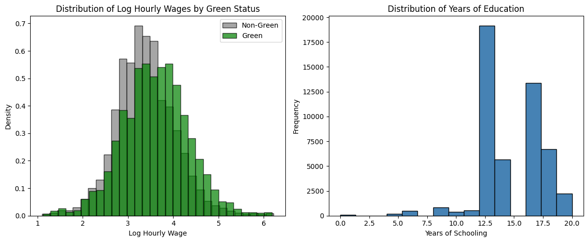
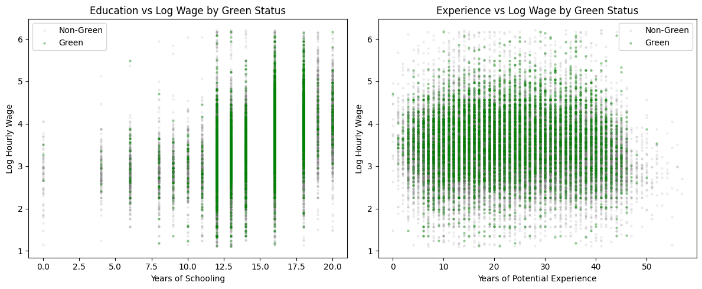
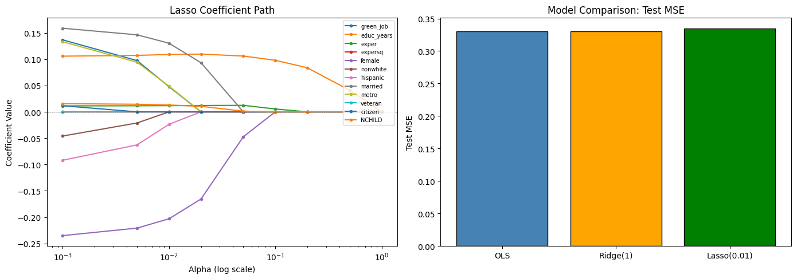

# Is there a green-job wage premium? Evidence from the 2025 CPS ASEC

EC3030 Computational Economics, Assessment 2 · City, University of London · John Headley · May 2026

**Files:** [`green_job_wage_premium.ipynb`](green_job_wage_premium.ipynb) (the full analysis, with outputs) · [`figures/`](figures/) · [`requirements.txt`](requirements.txt)

## Question

Do workers in green occupations earn more than comparable workers in other occupations? The notebook estimates the wage premium attached to a green job in the United States, conditional on human capital and demographics, and uses the same specification to compare OLS with ridge and lasso regression, out-of-sample prediction error, and a set of regression diagnostics.

## Data

- **Workers:** the 2025 Annual Social and Economic Supplement of the Current Population Survey (CPS ASEC, IPUMS-CPS variables), cleaned to **49,583 wage earners** with 31 variables. The hourly wage is annual wage income divided by weeks worked times usual weekly hours (`INCWAGE / (WKSWORK1 × UHRSWORKLY)`); the dependent variable is its log.
- **Green occupations:** a list of **138 green occupations** identified by SOC code (`GreenTask_AppA.csv`), mapped to **55 Census occupation codes** with a SOC-to-Census crosswalk (`soc_to_census_occ`). A worker holds a green job if their Census occupation code is in that set: **5,157 workers (10.4%)** do.
- **Controls built from the raw variables:** years of schooling (from the IPUMS `EDUC` categories), potential experience ($\text{age} - \text{schooling} - 6$, floored at 0) and its square, and dummies for female, non-white, Hispanic, married, metropolitan area, veteran and citizen, plus the number of own children in the household.

The data files are **not redistributed** here (IPUMS extracts may not be shared; see `.gitignore`), so the notebook cannot be re-run without them.

### Summary statistics by green status

| | Non-green | Green | Difference |
|---|---|---|---|
| Log hourly wage | 3.383 | 3.604 | +0.221 |
| Hourly wage ($) | 37.46 | 48.34 | +10.88 |
| Years of schooling | 14.36 | 14.80 | +0.43 |
| Potential experience | 22.60 | 22.58 | −0.02 |
| Female | 0.495 | 0.444 | −0.051 |
| Non-white | 0.240 | 0.207 | −0.033 |
| Hispanic | 0.219 | 0.175 | −0.044 |
| Married | 0.583 | 0.618 | +0.035 |
| Metro | 0.839 | 0.858 | +0.019 |
| Veteran | 0.048 | 0.043 | −0.005 |
| Citizen | 0.791 | 0.809 | +0.018 |
| Number of children | 1.049 | 1.062 | +0.013 |





## Method

Mincer-type wage equation estimated by OLS:

$$\ln w_i = \beta_0 + \beta_1\, Green_i + \beta_2\, Educ_i + \beta_3\, Exper_i + \beta_4\, Exper_i^2 + \gamma' D_i + \varepsilon_i$$

where $D_i$ collects the female, non-white, Hispanic, married, metro, veteran and citizen dummies and the number of children. The same design matrix is then used for:

1. **Ridge and lasso** (`scikit-learn`) at penalties $\alpha \in \{0.01, 0.1, 1, 10\}$, and a lasso coefficient path over $\alpha \in [0.001, 1]$;
2. **Out-of-sample prediction:** an 80/20 train–test split (39,666 / 9,917 observations, `random_state = 42`) comparing the test MSE of OLS, ridge ($\alpha = 1$) and lasso ($\alpha = 0.01$);
3. **Diagnostics:** Breusch–Pagan test for heteroskedasticity with HC1 robust standard errors, variance inflation factors, and the Ramsey RESET test (powers 2 and 3).

## Results

### OLS (dependent variable: log hourly wage, N = 49,583, R² = 0.272)

| Variable | Coefficient | SE | t |
|---|---|---|---|
| **Green job** | **0.1466** | 0.008 | 17.41 |
| Years of schooling | 0.1054 | 0.001 | 100.86 |
| Experience | 0.0112 | 0.001 | 10.87 |
| Experience² | −0.0001 | 0.000 | −6.56 |
| Female | −0.2382 | 0.005 | −45.39 |
| Non-white | −0.0519 | 0.007 | −7.92 |
| Hispanic | −0.0987 | 0.007 | −13.59 |
| Married | 0.1620 | 0.006 | 27.73 |
| Metro | 0.1429 | 0.007 | 19.90 |
| Veteran | 0.0086 | 0.012 | 0.70 |
| Citizen | 0.0152 | 0.007 | 2.10 |
| Number of children | 0.0159 | 0.002 | 6.52 |
| Intercept | 1.6138 | 0.021 | 76.72 |

Conditional on schooling, experience and demographics, a green job is associated with hourly wages **0.147 log points higher** (SE 0.0084; with HC1 robust standard errors SE 0.0089, t = 16.6). All coefficients except the veteran dummy are significant at the 5% level.

### Ridge, lasso and prediction error

Ridge leaves the coefficients essentially unchanged at every penalty (green job 0.1466 → 0.1463 at $\alpha = 10$). Lasso shrinks the green-job coefficient to 0.048 at $\alpha = 0.01$ and sets it to zero from $\alpha = 0.02$; the variables that survive longest are years of schooling, experience and its square, the female dummy and the number of children, and only schooling and experience² remain at $\alpha = 0.5$.

| Model | Train MSE | Test MSE |
|---|---|---|
| OLS | 0.324880 | 0.330397 |
| Ridge (α = 1) | 0.324880 | 0.330397 |
| Lasso (α = 0.01) | 0.328836 | 0.334334 |



### Diagnostics

| Test | Statistic | p-value | Conclusion |
|---|---|---|---|
| Breusch–Pagan (heteroskedasticity) | LM = 196.46 | 1.8 × 10⁻³⁵ | Reject homoskedasticity; HC1 robust SEs reported above |
| Ramsey RESET (powers 2 & 3) | F = 335.58 | 1.7 × 10⁻¹⁴⁵ | Reject the linear functional form |

Variance inflation factors are high for experience (83.0), experience squared (43.0) and years of schooling (17.9) — the three variables are linked by construction, since potential experience is age minus schooling minus 6 — and low for the green-job dummy (1.12) and the other controls (1.1–6.3).

## Reproducing

```bash
pip install -r requirements.txt
jupyter notebook green_job_wage_premium.ipynb
```

The notebook expects `cps_asec2025_clean.csv`, `GreenTask_AppA.csv` and the crosswalk module `soc_to_census_occ.py` in the same folder. The CPS ASEC data are available from [IPUMS-CPS](https://cps.ipums.org/) under their terms of use.

---

John Headley · BSc Economics & Econometrics, City, University of London
